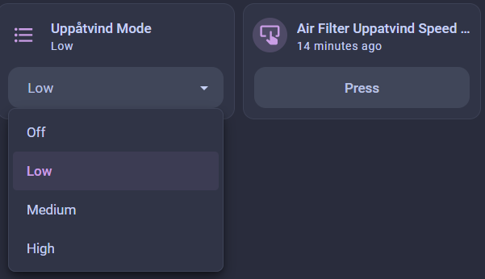

# ESPHome + Ikea UPPÅTVIND

> See also [horvathgergo/esp8266-for-uppatvind](https://github.com/horvathgergo/esp8266-for-uppatvind) which is a project to replace the board in the UPPÅTVIND with a custom board powered by an ESP866.

## Overview

This is a modification of the [Ikea UPPÅTVIND](https://www.ikea.com/us/en/p/uppatvind-air-purifier-60498228/) air purifier into a "smart" purifier, specifically by using ESP8266 or ESP32 wifi microcontroller with [ESPHome](https://esphome.io/) so that the air purifier can be remotely controlled by [Home Assistant](https://www.home-assistant.io/).
I used an ESP32-C6 (Seeed Studio XIAO ESP32-C6) and used an european UPPÅTVIND (from austria, dont know if there are different versions but just in case there are differences i wanted to let you know it)

The goal is to be able to remotely:
- View UPPÅTVIND fan speed
- Change the UPPÅTVIND fan speed

This can be done using an ESP8266 or ESP32 to:
- Sense the LED brightness, which matches the fans speed (off, low, medium, high)
- select preferred speed and it changes it automatically 
- Press the button to change the fan speed



## Disassembly of the UPPÅTVIND

The case is held together with triangle head screws:


A T8 Torx bit fits in these screws. A 3 to 3.2mm flat head slot screwdriver also works. 

On some revisions, after removing the 5 triangle screws, the face is still held on by clips along the edge. I jammed a flat head screwdriver into the gaps and broke each of the inside clips along the edges.

The board is powered from by 24V DC from the 2-pin connector.

The 24V is stepped down to 5V (U2 and surrounding components make a switched-mode power supply)

There is 8-pin microcontroller (U1) that reads the inputs from the 2 buttons, controls the 2 LEDs, enables the fan power, and generates the PWM to set the fan speed.

The microcontroller runs off of 5V  


## Wiring

I used a ESP32-C6 board. Any ESP8266 or ESP32 would work provided it can run off of 5V power, e.g. the board has a voltage regular.


 ⚠️ For signal voltage, the UPPÅTVIND MCU signals are at 5V and ESP8266/ESP32 are 3.3V (I think both are rated up to 3.6V). To be safe you _should_ use a level-shifter between UPPÅTVIND and the ESP chip. 
 I used 2 resistors and it works too.


| UPPÅTVIND | ESP32     | Notes                                                      |
| --------- | --------  | ---------------------------------------------------------- |
| TP2       | GND       |
| TP3       | 5V        |
| TP4       | D3/GPIO21 | TP4 is between the button switch at S1 and the UPPÅTVIND   |
| TP7       | D2/GPIO2  | TP7 is between anode (positive) side of LED1 the UPPÅTVIND |


### Button

The main button the UPPÅTVIND is active-low switch. It's schematic is like:
```
               S1
              _|_
U1--R1--TP4--o   o--GND
```

The 8-pin MCU U1 is set up as an pulled-up input pin. When the S1 is pressed it grounds the pins.

For the ESP32 to trigger the input, a Wemos output pin is connected to exposed cooper at TP4. The Wemos can then momentary set it's output pin to low similar to physically pressing the button at S1.


```
               S1
              _|_
U1--R1--TP4--o   o--GND
         |
         |
       ESP32
```

### LED

The main LED (LED1) of the UPPÅTVIND has 4 states, off, and low, medium, and high brightnesses. The PWM is used to control the brightness.

The LED has similar wiring but instead of the ESP32 using an output ping, the it'll uses an input pin connected to TP7. The ESP32 can then measure the pulse width to sense the LED brightness.


```
U1--TP7--LED1--GND
     |
     |
   ESP32
```


### Wiring Diagram

IKEA UPPÅTVIND MAIN PCB
          ┌──────────────────────────────────────┐
          │  [5V Power / TP3] ───────────────────┼──────────► ESP32 5V
          │  [GND Rail / TP2] ───────────────────┼──────────► ESP32 GND
          │                                      │
          │  [TP4 - Button Test Point] ──────────┼──────────► ESP32 GPIO21/D3
          │                                      │
          │  [TP7 - Fan Speed LED] ───[1kΩ]──┬───┼──────────► ESP32 GPIO2/D2
          └──────────────────────────────────┼───┘
                                           [2kΩ]
                                             │
                                         GND / TP2


## ESPHome

[ESPHome](https://esphome.io/)


Example ESPHome YAML configuration file

```yaml
# Board: Seeed Studio XIAO ESP32C6 (Seeed Studio)
# Definition: definitions/boards/seeed_xiao_esp32c6/manifest.yaml

esphome:
  name: airfilter
  friendly_name: AirFilter

esp32:
  variant: esp32c6
  flash_size: 4MB
  framework:
    type: esp-idf

logger:

api:
  encryption:
    key: "yourKey"

ota:
  - platform: esphome

wifi:
  ssid: "YourWIFI"
  password: YourWIFIPW
  ap:
    ssid: "AirFilter"
    password: "YourPassword"


    
# Output connected to TP4 (Button) via XIAO pin D2 (GPIO21)
output:
  - platform: gpio
    id: tp4_output
    pin: GPIO21  # Standard digital output
    inverted: true  
      # "inverted" used so the ESP32 does't pull the pin 
      # up or down when it's not being pressed.


button:
  - platform: template
    name: "Uppatvind Speed Button"
    id: simulate_button_press
    on_press:
      - output.turn_on: tp4_output   # Pulls LOW (since we know a brief touch works)
      - delay: 150ms
      - output.turn_off: tp4_output  # Releases


sensor:
  - platform: pulse_width
    pin: GPIO2
    name: "LED pulse width"
    id: led_duty_cycle
    update_interval: 500ms
    filters:
      - multiply: 1000000
```

## Change Filter LED

There is a red LED on the UPPÅTVIND for the filter change indicator. This LED seems to briefly turns on when the UPPÅTVIND powers up, and I assume it'll turn on when the filter needs to be changed. 
I haven't had the UPPÅTVIND long enough for the LED to turn on. It's probably based on total runtime time since Ikea suggests changing filter 6 months.

This LED (which is at LED2/TP6) could also be wired up to the ESP8266/ESP32 so its state can be sent to Home Assistant to trigger a notification.

## HomeAssistant sensor and script

I put this in the configuration.yaml in my HomeAssistant.
I then get a "select" sensor in HA which i can change and the level of the fan changes.

The levels of the fan correlate to the led pulse width, but its weird, the off state isnt always the same for me and the other pulse width numbers differ 1-2 from time to time.

```yaml
template:
  - select:
      - name: "Uppåtvind Mode"
        unique_id: uppatvind_air_purifier_mode
        state: >-
          
           Low
           Medium
           High
           Off
          

                options: "{{ ['Off', 'Low', 'Medium', 'High'] }}"
        
        # When you select a mode in HA, trigger the calculation script
        select_option:
          - action: script.turn_on
            target:
              entity_id: script.set_uppatvind_mode
            data:
              variables:
                target_mode: "{{ option }}"

script:
  set_uppatvind_mode:
    alias: "Set Uppatvind Mode"
    sequence:
      - variables:
          current_val: "{{ states('sensor.airfilter_led_pulse_width') | float(0) }}"
          current_mode: >-
             Low
             Medium
             High
             Off
            
          mapping:
            "Off": 0
            "Low": 1
            "Medium": 2
            "High": 3
          current_idx: "{{ mapping.get(current_mode, 0) }}"
          target_idx: "{{ mapping.get(target_mode, 0) }}"
          # Calculate exact steps forward in the cycle (Off -> Low -> Med -> High -> Off)
          steps: "{{ (target_idx - current_idx + 4) % 4 }}"
      
      - condition: template
        value_template: "{{ steps > 0 }}"

      - repeat:
          count: "{{ steps }}"
          sequence:
            - action: button.press
              target:
                entity_id: button.airfilter_uppatvind_speed_button  # Make sure this matches your exact button entity ID!
            - delay: "00:00:00.8"
```

## Automation
I use the air filter in combination with a motion sensor, so if my cat goes to their toilet and activates the sensor the air filter level is increased to medium for 10 minutes and after that back to low.

